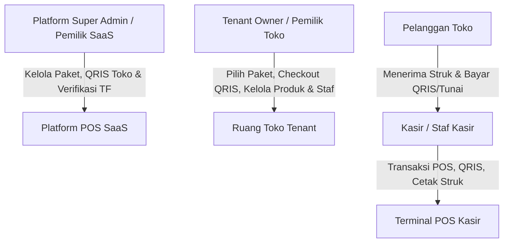
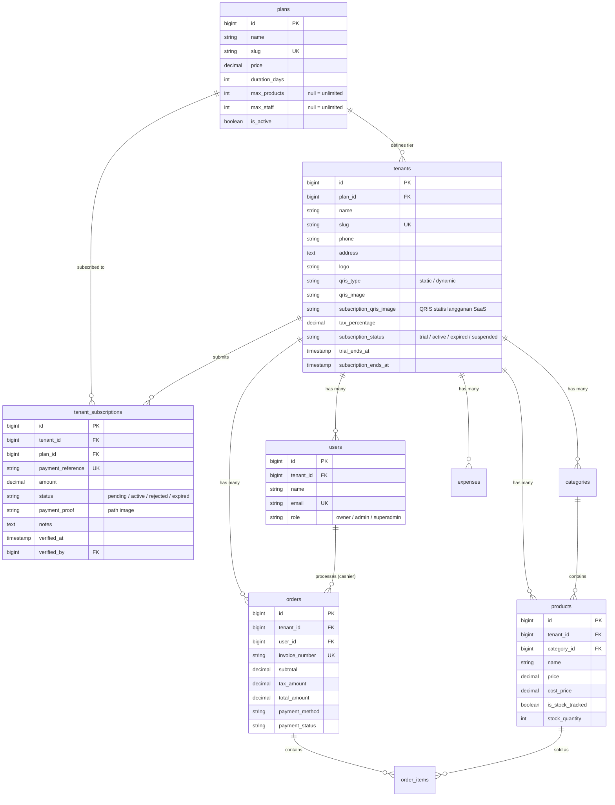

# Product Requirements Document (PRD): POS SaaS Platform

**Dokumen Versi:** 2.0.4  
**Tanggal:** 22 Oktober 2026  
**Status:** Completed (Fase 1, 2B, 3 Selesai & Seluruh Tampilan Adaptif Multi-Device)  
**Target Produk:** Cloud-based Multi-Tenant POS (Point of Sale) & Store Management SaaS

---

## 1. Executive Summary & Visi Produk

### 1.1 Visi
Mengubah aplikasi kasir lokal (**ProjectKasir**) menjadi platform **Multi-Tenant SaaS (Software as a Service)** kelas ritel dan F&B (*Food & Beverage*) di Indonesia, yang memungkinkan pemilik bisnis (UMKM, coffee shop, resto, dan toko ritel) untuk mendaftar secara mandiri (*self-service onboarding*), mengelola kasir, stok barang, laporan laba rugi, dan menerima pembayaran digital (QRIS) secara terisolasi dan aman.

### 1.2 Masalah yang Diselesaikan
- **Biaya setup software kasir tradisional mahal:** Pelaku usaha sering dibebani biaya instalasi server lokal atau lisensi beli putus yang kaku.
- **Pencatatan keuangan F&B tidak akurat:** Sering kali sistem kasir hanya mencatat omzet kotor tanpa memperhitungkan Harga Pokok Penjualan (HPP / COGS) dan biaya operasional.
- **Ketergantungan Payment Gateway:** Kebanyakan POS memotong biaya transaksi besar atau menahan uang kasir. Dengan model **BYO (Bring Your Own) Gateway**, merchant memiliki kendali penuh atas rekening bank dan kas mereka.

---

## 2. Target Pengguna & Personas



1. **Platform Super Admin (Pemilik SaaS):**
   - Mengelola daftar tenant, paket berlangganan (*pricing tiers*), kuota toko, dan analitik pendapatan platform (MRR).
   - Saluran kontak resmi WhatsApp: **`082260693366`** (`+62 822-6069-3366`) untuk konfirmasi pembayaran langganan, bantuan onboarding, dan customer support.
   - Menetapkan barcode QRIS statis pembayaran langganan khusus per toko (`tenants.subscription_qris_image`).
   - Menerima, memeriksa bukti transfer, serta memverifikasi/menolak pengajuan perpanjangan/upgrade paket merchant.
2. **Tenant Owner (Pemilik Toko):**
   - Mendaftar toko secara mandiri (*self-onboarding*).
   - Memilih paket langganan (Starter, Pro, Enterprise) di `/subscription/plans`.
   - Melakukan checkout dengan scan barcode QRIS khusus toko, mengunggah bukti transfer, dan konfirmasi langsung ke WhatsApp Super Admin.
   - Mengatur identitas toko, persentase pajak (PPN/PB1), dan API Key Midtrans toko.
   - Mengelola katalog produk, stok, dan kasir sesuai batas kuota paket.
   - Mencatat pengeluaran operasional dan memantau laba bersih harian/bulanan.
3. **Kasir / Staff Barista:**
   - Akses cepat dan mudah ke antarmuka terminal POS (`/pos`).
   - Melakukan checkout cepat (Tunai / QRIS dinamis / QRIS statis).
   - Cetak struk kasir thermal 58mm dan tiket dapur otomatis.

---

## 3. Tech Stack & Arsitektur Sistem

- **Backend Framework:** Laravel 11/12 (PHP 8.3)
- **Frontend / Client:** React 18 + Inertia.js v2 + Tailwind CSS
- **Database:** Relational Single-Database Multi-Tenancy (SQLite untuk local dev, MySQL / PostgreSQL untuk production)
- **Payment Gateway:** Midtrans Core API (Dynamic QRIS GoPay/ShopeePay) & Manual Static QRIS Transfer
- **Document Generator:** DomPDF (Ekspor Laporan PDF Laba Rugi Bulanan)
- **Isolasi Data:** Global Eloquent Scope (`TenantScope`) & Trait (`BelongsToTenant`)

---

## 4. Status Fitur: Apa yang Sudah Selesai vs Roadmap

| Modul / Fitur | Deskripsi | Status |
| :--- | :--- | :--- |
| **Terminal Kasir POS** | Antarmuka kasir cepat, filter kategori, kalkulasi subtotal & pajak, nominal tunai & kembalian. | ✅ Selesai |
| **QRIS Statis Manual (UMKM)** | Upload barcode QRIS toko mandiri (BCA, Mandiri, BRI, GoPay, Dana) + kasir verifikasi manual sebelum checkout. | ✅ Selesai |
| **QRIS Midtrans Dinamis** | Generate barcode QRIS langsung dari terminal POS secara *real-time* via Midtrans API. | ✅ Selesai |
| **Modal Struk Thermal Live** | Pratinjau struk thermal 58mm langsung di layar POS selesai bayar QRIS/Tunai + tombol cetak anti-popup blocker. | ✅ Selesai |
| **Identitas & Logo Toko Dinamis** | Owner upload logo & nama toko; otomatis tampil di Navbar Admin, POS, Struk Thermal 58mm, & PDF Laporan. | ✅ Selesai |
| **Cetak Struk Thermal & Dapur** | Format standar thermal printer 58mm dengan logo toko grayscale & pemotong otomatis (*page break*) untuk Ticket Dapur. | ✅ Selesai |
| **Manajemen Produk & Stok** | CRUD produk, toggle lacak stok, upload foto, harga jual, dan harga modal (HPP). | ✅ Selesai |
| **Pencatatan Biaya (Expenses)** | Pencatatan biaya operasional toko (sewa, listrik, gaji, bahan habis pakai). | ✅ Selesai |
| **Laporan Finansial Komprehensif** | Analisis Omzet, HPP (COGS), Laba Kotor, Laba Bersih, Top 5 Menu, dan Ekspor PDF. | ✅ Selesai |
| **Pondasi Multi-Tenancy** | Tabel `tenants`, kolom `tenant_id` di seluruh tabel data, Trait `BelongsToTenant`, dan `TenantScope`. | ✅ Selesai |
| **Registrasi Toko Mandiri** | Registrasi tenant baru + akun owner + otomatis paket Free Trial 14 hari + kategori awal. | ✅ Selesai |
| **Pengaturan Toko & BYO Gateway** | Halaman `/store-settings` untuk ubah nama, logo, metode QRIS (Statis/Dinamis), tarif pajak, dan API Midtrans. | ✅ Selesai |
| **Role & Console Super Admin** | Halaman `/superadmin/dashboard` untuk pantau seluruh merchant, status operasional, suspend toko, perpanjang masa aktif. | ✅ Selesai |
| **Subscription Enforcement Middleware** | Middleware `EnsureTenantIsSubscribed` memblokir akses kasir/owner jika trial atau langganan habis. | ✅ Selesai |
| **Halaman Peringatan Expired & Paywall** | Halaman `/subscription/expired` ramah pengguna, status toko, jaminan keamanan data, & perpanjang via WhatsApp. | ✅ Selesai |
| **Notifikasi Peringatan H-3 Trial** | Banner peringatan sticky H-3 otomatis di bagian atas antarmuka POS, Dashboard, dan Pengaturan. | ✅ Selesai |
| **Tier Paket & Skema Langganan** | Migrasi tabel `plans` (Free Trial, Starter, Pro, Enterprise) dan `tenant_subscriptions`. | ✅ Selesai |
| **QRIS Statis Khusus Per Toko** | Super Admin dapat mengupload barcode QRIS statis langganan spesifik per toko (`subscription_qris_image`). | ✅ Selesai |
| **Checkout & Verifikasi Bukti TF ke WA** | Modal scan QRIS toko, unggah bukti transfer, no referensi instan, dan tombol otomatis buka WhatsApp konfirmasi. | ✅ Selesai |
| **Super Admin Approval & Verification** | Antrean verifikasi bukti transfer langganan di Super Admin Console + aktivasi paket instan. | ✅ Selesai |
| **Penegakan Kuota Produk & Staf** | Kuota produk (`max_products`) dan staf kasir (`max_staff`) ditegakkan di backend Controller dan diberi visualisasi kuota di UI. | ✅ Selesai |
| **Menu & Halaman Dashboard Super Admin** | Halaman eksekutif (`/superadmin/dashboard`) berisi ringkasan pendapatan langganan SaaS, pendapatan bulan berjalan, jumlah toko terdaftar, toko aktif, masa trial, distribusi paket merchant, pendaftaran toko terbaru, dan mutasi tagihan langganan. | ✅ Selesai |
| **Halaman Manajemen Toko (Terpisah)** | Halaman khusus operasional toko (`/superadmin/tenants`) untuk pencarian toko, penetapan barcode QRIS tagihan khusus merchant, penambahan masa aktif (+30 hari), dan kontrol aktivasi/suspend toko. | ✅ Selesai |
| **Halaman Billing & Verifikasi (Terpisah)** | Halaman khusus finansial & verifikasi langganan (`/superadmin/billing`) untuk antrean verifikasi bukti transfer QRIS merchant (lightbox bukti TF, approve/reject), riwayat mutasi pembayaran lengkap, dan metrik penerimaan SaaS. | ✅ Selesai |
| **Multi-Outlet (Cabang Tambahan)** | Dukungan 1 tenant memiliki banyak cabang (*outlet*), transfer stok antar cabang, dan laporan gabungan. | ⏳ Fase 4 |

---

## 5. Arsitektur Data & Model Keamanan (Multi-Tenancy)

### 5.1 Skema Relasi Database



### 5.2 Strategi Zero-Leak Isolation
1. **Otomatisasi Query (Read):** Setiap model bisnis menerapkan `BelongsToTenant` yang mengaktifkan `TenantScope`. Ketika pengguna dengan `tenant_id` login, query:
   ```sql
   SELECT * FROM products WHERE is_active = 1
   ```
   Secara transparan diubah oleh Eloquent menjadi:
   ```sql
   SELECT * FROM products WHERE is_active = 1 AND products.tenant_id = ?
   ```
2. **Otomatisasi Penyimpanan (Write):** Event observer `creating` pada trait memastikan kolom `tenant_id` langsung terisi dari ID tenant user yang sedang login, mencegah human-error lupa mengisi kolom `tenant_id`.
3. **Route Model Binding Protection:** Jika Owner Toko A mencoba mengakses data Toko B melalui URL (`/products/99/edit`), Laravel secara otomatis melempar `404 Not Found` karena filter `tenant_id` membatalkan eksistensi record tersebut untuk Toko A.

---

## 6. Spesifikasi Kebutuhan Fungsional (Functional Requirements)

### FR-01: Onboarding, Subscription Lifecycle & Enforcement
- **FR-01.1:** Pengguna baru dapat mendaftar melalui form `/register` dengan menyertakan Nama Toko, Nama Owner, Email, dan Password.
- **FR-01.2:** Sistem membuat tenant baru dengan status `subscription_status = 'trial'` dan `trial_ends_at = now() + 14 hari` dengan default paket Free Trial.
- **FR-01.3:** Sistem otomatis membuat data kategori awal (*Makanan* dan *Minuman*) agar toko siap pakai.
- **FR-01.4:** Middleware `EnsureTenantIsSubscribed` memblokir akses kasir/owner ke rute terproteksi (`/pos`, `/dashboard`, `/products`, dll.) jika masa trial atau paket langganan habis, dan mengarahkan otomatis ke halaman paywall.
- **FR-01.5:** Halaman peringatan *Subscription Expired / Renewal Notice* (`/subscription/expired`) menampilkan status akun toko, jaminan keamanan data, tautan langsung ke halaman pemilihan paket (`/subscription/plans`), serta tombol WhatsApp Super Admin.
- **FR-01.6:** Banner peringatan sticky H-3 otomatis muncul di bagian atas antarmuka POS, Dashboard, dan Pengaturan jika sisa masa trial/langganan toko <= 3 hari. Tombol "Perpanjang Sekarang" (ikon bintang `stars`) mengarahkan merchant langsung ke halaman **Paket & Billing** (`/subscription/plans`) yang menyediakan 3 pilihan paket dengan opsi perpanjang paket aktif atau beralih ke paket baru.

### FR-02: Konfigurasi Toko & Payment Gateway (BYO Key)
- **FR-02.1:** Pemilik toko dapat mengubah identitas toko pada `/store-settings` (Nama Toko, Telepon, Alamat). Field Alamat Toko bersifat wajib diisi (**required**) sebagai standar identitas bisnis resmi dan kelengkapan struk kasir thermal.
- **FR-02.2:** Pemilik toko dapat menentukan tarif pajak transaksi (misal: 11% untuk PB1, atau 0% untuk non-PKP).
- **FR-02.3:** Pemilik toko dapat memasukkan kredensial Midtrans milik sendiri (Server Key & Client Key) serta memilih mode Sandbox atau Production.
- **FR-02.4:** Pemilik toko dapat mengunggah logo toko resmi dan foto barcode QRIS statis (format JPG, PNG, WebP hingga 2MB).
- **FR-02.5:** Struk thermal kasir 58mm otomatis mencetak logo toko (grayscale), nama toko, dan alamat toko. Nomor telepon toko dilengkapi opsi box centang (*checkbox toggle*) untuk dicetak atau tidak dicetak pada struk kasir thermal sesuai kebutuhan merchant (`show_phone_on_receipt`).
- **FR-02.6:** Onboarding Identitas Toko Pengguna Baru: Saat pemilik toko baru login (`AuthenticatedSessionController`) atau baru mendaftar (`RegisteredUserController`), sistem secara otomatis mendeteksi kelengkapan identitas toko (alamat toko). Jika belum diisi, sistem langsung mengarahkan pengguna ke halaman Pengaturan Toko (`/store-settings`) dengan notifikasi panduan agar data identitas toko dilengkapi terlebih dahulu sebelum kasir melayani transaksi.

### FR-03: Operasional Kasir (POS) & Penjualan
- **FR-03.1:** Kasir hanya dapat melihat produk dan kategori milik tokonya sendiri.
- **FR-03.2:** Kalkulasi pajak pada transaksi kasir dihitung berdasarkan `tax_percentage` milik tenant terkait.
- **FR-03.3:** Permintaan QRIS dinamis menggunakan Server Key tenant yang bersangkutan (fallback ke platform key jika belum diisi).
- **FR-03.4:** Untuk QRIS statis, terminal POS menampilkan foto barcode toko dan nominal tagihan; kasir wajib menandai kotak konfirmasi verifikasi manual bahwa dana telah masuk sebelum tombol checkout diaktifkan.
- **FR-03.5:** Pengurangan stok produk saat checkout dilindungi dengan *pessimistic row locking* (`lockForUpdate`) untuk menghindari *race condition* saat transaksi ramai.
- **FR-03.6:** Ketika transaksi checkout (QRIS atau Tunai) berhasil, sistem memunculkan Modal Struk Kasir dengan pratinjau struk thermal 58mm langsung di layar dan tombol cetak satu klik (*bypass browser popup blocker*).
- **FR-03.7:** Tabel riwayat transaksi pada dashboard pemilik toko menyediakan tombol cetak ulang struk (*reprint receipt*) untuk setiap transaksi lampau.

### FR-04: Laporan Keuangan & HPP
- **FR-04.1:** Perhitungan omzet kotor, total HPP (*Cost of Goods Sold*), laba kotor, dan laba bersih (setelah dikurangi pengeluaran operasional).
- **FR-04.2:** Pemilik toko dapat mengunduh berkas laporan bulanan berformat PDF dengan logo toko dan nama file dinamis sesuai nama toko.

### FR-05: Paket Langganan, Kuota & Billing QRIS Statis (Fase 3)
- **FR-05.1:** Katalog paket langganan tersedia di `/subscription/plans` menampilkan perbandingan fitur Starter (Rp49rb), Pro (Rp129rb), dan Enterprise (Rp299rb).
- **FR-05.2:** Super Admin dapat mengunggah barcode QRIS statis khusus untuk toko tertentu melalui Konsol Super Admin (`/superadmin/dashboard`).
- **FR-05.3:** Ketika owner toko memilih paket di `/subscription/plans`, sistem menampilkan modal pembayaran QRIS statis toko yang bersangkutan beserta nominal tagihan dan instruksi transfer.
- **FR-05.4:** Lampiran bukti transfer pembayaran bersifat **wajib (`required`)**. Tombol "Kirim Bukti Transfer ke WhatsApp Admin" dinonaktifkan (`disabled`) dan tampil redup hingga pengguna memilih file gambar bukti transfer yang valid (JPG/PNG/WebP maks 3MB). Saat tombol diklik, sistem menyimpan record `tenant_subscriptions` berstatus `pending` dan membuka aplikasi WhatsApp Super Admin dengan pesan konfirmasi pre-filled.

- **FR-05.5:** Super Admin Console menampilkan antrean verifikasi bukti transfer langganan, dengan fitur pratinjau gambar bukti transfer, aksi "Verifikasi & Aktifkan" (otomatis memperpanjang masa aktif toko dan mengubah plan_id), serta aksi "Tolak" dengan catatan.
- **FR-05.6:** Penegakan kuota produk (`max_products`) dan akun staf/kasir (`max_staff`) secara ketat:
  - Backend controller (`ProductController` & `AdminController`) melempar error validasi jika kuota tercapai.
  - Halaman antarmuka menampilkan pill indikator kuota terpakai (contoh: `Kuota: 9 / 20 Produk (Free Trial)`).
  - Banner peringatan kuota penuh muncul otomatis dengan tombol pintasan "Upgrade Paket".

---

## 7. Model Bisnis & Rencana Monetisasi (SaaS Pricing)

| Paket | Target | Estimasi Harga | Batasan & Fitur |
| :--- | :--- | :--- | :--- |
| **Free Trial** | Calon pelanggan baru | Rp 0 / 14 Hari | 1 Outlet, Maks. 20 Produk, 1 Akun Kasir, Struk Standard. |
| **Starter** | Usaha mikro / Booth / Gerobak | Rp 49.000 / bln | 1 Outlet, Maks. 100 Produk, 2 Akun Kasir, Laporan Harian, QRIS Statis. |
| **Pro (Recommended)** | Kafe, Resto, Toko Ritel | Rp 129.000 / bln | 1 Outlet, Produk Unlimited, Kasir Unlimited, Ekspor PDF Laba Rugi, BYO Midtrans QRIS Dinamis. |
| **Multi-Outlet (Enterprise)** | Bisnis dengan banyak cabang | Rp 299.000 / bln | Hingga 5 Outlet/Cabang, Multi-gudang stok, Laporan gabungan. |

---

## 8. Kebutuhan Non-Fungsional (Non-Functional Requirements)

1. **Keamanan Data (Data Isolation):** Tidak boleh ada kebocoran data antar-tenant (*zero data leakage*). Uji penetrasi dan automated test wajib memverifikasi bahwa query tanpa tenant scope diblokir.
2. **Performa Kasir (Low Latency):** Halaman kasir (`/pos`) harus merespons penambahan item ke keranjang dan proses checkout dalam waktu kurang dari **200ms**.
3. **Kompatibilitas Hardware:** Halaman struk wajib kompatibel dengan printer thermal Bluetooth/USB 58mm standar ESC/POS dan peramban modern (Chrome, Edge, Safari).
4. **Reliabilitas:** Desain transaksi menggunakan database transactions (`DB::beginTransaction` & `DB::commit`) pada checkout untuk menjamin integritas data stok dan pesanan.

---

## 9. Roadmap Pengembangan Mendatang

### Fase 1 & 2A: Pondasi Multi-Tenancy & Super Admin Console (✅ Selesai)
- Global Scope (`TenantScope`), Trait `BelongsToTenant`.
- Portal Super Admin `/superadmin/dashboard` (metrik MRR, toggle status toko, perpanjang masa aktif).
- Branding Toko Dinamis (Logo, Nama Toko di POS, Dashboard, Struk, PDF).
- Dual Mode QRIS: Statis manual (unggah barcode + verifikasi kasir) & Dinamis via Midtrans.

### Fase 2B: Subscription Enforcement (✅ Selesai)
- Pembuatan Middleware `EnsureTenantIsSubscribed`.
- Halaman peringatan *Subscription Expired / Renewal Notice* (`/subscription/expired`).
- Notifikasi Banner Sticky H-3 sebelum masa trial/langganan berakhir.

### Fase 3: Automated Billing & Paket Langganan (✅ Selesai)
- Migrasi tabel `plans` dan `tenant_subscriptions`.
- Integrasi pembayaran langganan SaaS via QRIS statis spesifik per toko (`tenants.subscription_qris_image`).
- Modal checkout QRIS statis, upload bukti transfer, dan tombol verifikasi langsung via WhatsApp ke Super Admin.
- Antrean verifikasi bukti transfer langganan di Super Admin Console (Approve & Reject).
- Penegakan kuota produk (`max_products`) dan akun staf per paket (`max_staff`) di backend dan frontend.

### Fase 4: Multi-Outlet & Advanced Inventory (Berikutnya)
- Cabang/outlet tambahan per tenant.
- Transfer stok antar cabang.
- Multi-gudang stok dan rekap kas kasir (*cash drawer shift reporting*).

---

## 10. Changelog & Riwayat Revisi PRD

Setiap penambahan atau perubahan fitur/alur pada sistem **POS SaaS** wajib dicatat pada tabel riwayat berikut:

| Versi | Tanggal | Modul / Fitur yang Berubah | Deskripsi Rinci Perubahan |
| :--- | :--- | :--- | :--- |
| **v1.0.0** | 20 Okt 2026 | Multi-Tenancy & Super Admin | Inisialisasi PRD, skema tabel `tenants`, kolom `tenant_id`, `TenantScope`, `BelongsToTenant`, role `superadmin`, dan portal `/superadmin/dashboard`. |
| **v1.1.0** | 20 Okt 2026 | Identitas & Branding Toko | Fitur upload logo toko & nama toko dinamis di `/store-settings`, terintegrasi ke Navbar Admin, POS kasir, Struk thermal 58mm, dan Header PDF Laporan. |
| **v1.2.0** | 20 Okt 2026 | Dual Mode QRIS (Statis UMKM) | Penambahan mode QRIS Statis (unggah barcode toko) bagi merchant tanpa payment gateway + verifikasi kasir manual sebelum tombol checkout aktif. |
| **v1.3.0** | 20 Okt 2026 | Modal Struk & Cetak Ulang | Modal pratinjau struk thermal 58mm langsung di layar POS selesai bayar QRIS/Tunai, detail breakdown QRIS di struk, mekanisme anti-popup blocker, dan tombol cetak ulang struk di tabel riwayat transaksi dashboard owner. |
| **v1.4.0** | 20 Okt 2026 | Subscription Enforcement (Fase 2B) | Middleware `EnsureTenantIsSubscribed`, Halaman Paywall/Expired `/subscription/expired` (status toko, jaminan aman data, WA renewal), dan Notifikasi Banner Sticky H-3 di POS, Dashboard, & Pengaturan. |
| **v1.5.0** | 20 Okt 2026 | Automated Billing & Paket Langganan (Fase 3) | Migrasi tabel `plans` & `tenant_subscriptions`, QRIS Statis langganan SaaS diinput Super Admin per toko, Halaman Checkout `/subscription/plans`, Upload Bukti TF & Konfirmasi via WA, Queue Approval Super Admin, Penegakan Kuota Produk & Staf per paket, Redesain Halaman Registrasi Toko (`/register`), serta Pembaruan Metrik Super Admin Dashboard (mengganti GMV kasir menjadi Total Pendapatan Langganan SaaS dari toko yang berlangganan dan label 'QRIS Tagihan SaaS'). |
| **v1.6.0** | 20 Okt 2026 | Pemisahan Menu & Halaman Super Admin | Memisahkan navigasi dan halaman Super Admin menjadi dua modul: Dashboard eksekutif dan Manajemen Toko & Billing terpadu. |
| **v1.7.0** | 20 Okt 2026 | Pemisahan Halaman Manajemen Toko & Billing | Memisahkan modul operasional menjadi 2 halaman mandiri sehingga konsol Super Admin kini memiliki 3 halaman dan menu navigasi terpisah: (1) **Dashboard** (`/superadmin/dashboard`), (2) **Manajemen Toko** (`/superadmin/tenants`) khusus pengelolaan merchant, kuota, perpanjangan +30 hari, dan upload barcode QRIS tagihan toko, serta (3) **Billing & Verifikasi** (`/superadmin/billing`) khusus antrean verifikasi bukti transfer QRIS manual, lightbox bukti transfer, aksi approve & reject dengan catatan, riwayat transaksi lengkap dengan pencarian, serta metrik finansial SaaS. |
| **v1.7.1** | 20 Okt 2026 | Perbaikan Label Kuota Unlimited | Memperbaiki format tampilan kuota paket unlimited: mengganti representasi nilai database `-1` (`-1 Produk` dan `-1 Staf`) menjadi label ramah pengguna: `"tidak ada batas Produk"` dan `"tidak ada batas Staf"` pada kartu paket Dashboard Super Admin dan tabel Manajemen Toko. |
| **v1.7.2** | 20 Okt 2026 | Refinement UI Halaman Billing | Menghapus 4 kartu metrik pendapatan yang redundan dan tombol pintasan 'Buka Manajemen Toko' pada halaman `/superadmin/billing` agar antarmuka fokus 100% pada antrean verifikasi bukti transfer dan riwayat mutasi pembayaran. |
| **v1.7.3** | 20 Okt 2026 | Filter Periode Bulan/Tahun Dashboard | Menghapus tombol pintasan 'Manajemen Toko' dan 'Billing & Mutasi' di header Dashboard Super Admin (`/superadmin/dashboard`) dan menggantikannya dengan kontrol dropdown Filter Periode (Bulan & Tahun). Seluruh metrik pendapatan periode terpilih, pendaftaran toko baru, serta tabel riwayat merchant dan mutasi tagihan kini terhubung secara dinamis dan reaktif menyaring data berdasarkan bulan dan tahun yang dipilih oleh Super Admin. |
| **v1.7.4** | 20 Okt 2026 | Nomor Kontak Resmi WhatsApp Super Admin | Menetapkan nomor WhatsApp resmi Super Admin **`082260693366`** (`6282260693366`) di konfigurasi `.env`, controller langganan, halaman pemilihan paket langganan (`/subscription/plans`), halaman paywall/expired (`/subscription/expired`), banner peringatan H-3 (`SubscriptionWarningBanner`), dan tautan bantuan pendaftaran (`/register`). |
| **v1.7.5** | 20 Okt 2026 | Perbaikan ReferenceError Errors Halaman Produk | Memperbaiki error `Uncaught ReferenceError: errors is not defined` pada komponen `ProductIndex` ([Products/Index.jsx](file:///d:/WEB/ProjectKasir/resources/js/Pages/Products/Index.jsx)) dengan menambahkan parameter `errors = {}` pada deklarasi props komponen agar banner kuota backend (`errors?.quota`) dapat dievaluasi secara aman tanpa runtime crash. |
| **v1.7.6** | 20 Okt 2026 | Sinkronisasi & Validasi Stok Real-Time (Kasir & Owner) | Mengimplementasikan validasi stok ketat di terminal kasir (`/pos`): produk dengan stok 0 dinonaktifkan (`disabled`) dengan overlay badge 'HABIS (0)' dan tidak dapat diklik. Produk dengan batas stok yang sudah dimasukkan penuh ke keranjang dinonaktifkan dengan badge 'DI KERANJANG (MAKS)' dan tombol increment `+` dinonaktifkan. Pada backend `OrderController@store`, menambahkan transaksi database dengan pessimistic locking (`lockForUpdate`), agregasi kuantitas item per `product_id`, validasi ketersediaan stok, dan otomatisasi pengurangan kuantitas stok produk (`$product->decrement('stock_quantity')`). Pada tabel Manajemen Produk Owner (`/products`), kolom stok diperbarui dengan badge visual berwarna ('Habis (0)' merah, 'Sisa: X unit' kuning/hijau, dan 'Tak Terbatas' untuk item non-tracked) yang otomatis berkurang setelah pesanan berhasil diproses di kasir. |
| **v1.7.7** | 21 Okt 2026 | Laporan Keuangan Eksekutif & Menu Engineering Paket Pro (Best Seller) | Menghadirkan sistem Laporan Keuangan Eksekutif berstandar akuntansi ritel/F&B profesional khusus untuk pemilik toko di Paket Pro (Best Seller): (1) Laporan Laba Rugi Komprehensif (Net Sales, HPP/COGS, Laba Kotor, Gross Margin %, Beban OPEX, Laba Bersih, Net Margin %, Pajak PB1/PPN, dan AOV); (2) Rekapitulasi Arus Kas Kasir (Cash Flow Settlement) yang memisahkan uang kas fisik di laci kasir vs saldo masuk rekening digital QRIS/Midtrans untuk mempermudah tutup buku kasir; (3) Analisis Profitabilitas Menu (Menu Engineering) yang membedah margin riil per porsi, biaya modal HPP, total laba kotor yang disumbangkan tiap produk, dan klasifikasi performa menu (Bintang Laba ⭐, Volume Cepat ⚡, Margin Tebal 💎, dan Standar); serta (4) Template Ekspor Dokumen Resmi PDF Pro A4 lengkap dengan kop surat logo toko, tabel terstruktur, rincian pengeluaran, dan lembar pengesahan tanda tangan kasir & owner. |
| **v1.7.8** | 21 Okt 2026 | Redesain PDF Laporan Keuangan Standar Audit Monokrom Profesional | Merespons instruksi pengguna untuk menghilangkan elemen warna-warni/kasual pada dokumen PDF: merombak total template [report.blade.php](file:///d:/WEB/ProjectKasir/resources/views/pdf/report.blade.php) menjadi format akuntansi monokrom/grayscale profesional standar audit. Menghilangkan seluruh badge berwarna (kuning/merah/hijau/biru neon) dan emoji; menerapkan kop surat resmi garis ganda institusional, penataan tabel bergaris formal abu-abu halus, garis penutup akuntansi garis bawah ganda (*double bottom border*) pada total laba bersih, serta optimalisasi margin kertas A4 sehingga dokumen 1 halaman tercetak sangat presisi, bersih, dan berwibawa bagi investor maupun pihak perbankan. |
| **v1.7.9** | 21 Okt 2026 | Penyesuaian Pengesahan Laporan PDF Pro | Menghapus blok tanda tangan "Disusun Oleh: Dimas Prayoga (Kasir / Head Barista)" pada template PDF laporan keuangan sesuai instruksi pengguna, sehingga lembar pengesahan hanya menampilkan blok pengesahan resmi di sisi kanan: "Diperiksa & Disetujui Oleh: Pemilik / Pengelola Toko" yang relevan untuk laporan eksekutif tingkat pemilik bisnis. |
| **v1.8.0** | 21 Okt 2026 | Polish Antarmuka Bersih & Minimalis (Executive Dashboard) | Merapikan antarmuka Laporan Keuangan Eksekutif Paket Pro: (1) Menyeragamkan palet warna 4 kartu metrik utama (Omzet, HPP, Laba Kotor, Laba Bersih) ke kontainer putih/netral minimalis bergaris halus tanpa degradasi warna mencolok dan memperbaiki tipografi judul agar tidak terpotong; (2) Menyederhanakan kartu Rekapitulasi Arus Kas Tunai vs QRIS dengan kartu netral yang bersih dan informatif; (3) Memperbaiki tampilan badge kolom 'Status Analisis' pada tabel Menu Engineering dengan menerapkan `inline-flex items-center justify-center whitespace-nowrap` dan padding presisi sehingga teks status ('Kontribusi Utama', 'Perputaran Cepat', 'Margin Tinggi', 'Standar') tidak pernah terputus atau bertumpuk menjadi dua kapsul terpisah; serta (4) Menambahkan `whitespace-nowrap` pada seluruh sel dan tajuk tabel transaksi agar tabel tetap rapi di segala resolusi layar. |
| **v1.8.1** | 21 Okt 2026 | Format Titik Nominal Mata Uang Rupiah pada Input Form | Mengimplementasikan pemformatan ribuan dengan titik (*thousands separator* `id-ID`) secara *real-time* pada field input nominal moneter: (1) Form Tambah & Edit Produk (`Harga Jual` dan `Harga Modal / HPP`); (2) Form Pencatatan Pengeluaran Operasional Toko (`Expenses`); serta (3) Terminal Kasir POS (`Uang Diterima Tunai`). Input menggunakan `type="text"` dengan `inputMode="numeric"`, otomatis menyaring karakter non-digit saat diketik, menampilkan angka berpemisah titik (contoh: `20.000` dan `15.000`), serta tetap mengirimkan nilai numerik murni (*raw digits*) ke backend sehingga validasi dan database tetap konsisten. |
| **v1.8.2** | 21 Okt 2026 | Standardisasi Penamaan Paket & Badge Dinamis Tenant | Menghapus label `(Best Seller)` dari nama paket di basis data tabel `plans` (sehingga nama paket bersih menjadi `'Pro'`, `'Starter'`, `'Enterprise'`, `'Free Trial'`) dan migrasi basis data. Merombak badge status paket di navbar Dashboard menjadi dinamis reaktif mengikuti paket tenant: jika paket toko adalah Pro maka tampil `PAKET PRO` (aksen amber), jika paket toko adalah Starter maka tampil `PAKET STARTER` (aksen biru), jika Enterprise maka `PAKET ENTERPRISE` (aksen ungu), dan jika trial maka `PAKET FREE TRIAL`. Menghilangkan teks hardcoded pada tombol unduh PDF (`Unduh Laporan (PDF)`) dan klasifikasi dokumen PDF dinamis `Lisensi Paket [Nama Paket]`. |
| **v1.8.3** | 21 Okt 2026 | Pembersihan Border Card Logo Toko | Menghilangkan styling bingkai kartu (`border border-outline-variant`, `shadow-sm`, dan `rounded-xl`) pada logo toko di seluruh bilah navigasi header (Dashboard, Produk, Kasir, Pengeluaran, Billing, Pengaturan, dan POS). Logo kini ditampilkan secara natural dan bersih (`object-contain rounded-full`) sehingga menyatu dengan bentuk asli gambar logo tanpa kotak batas buatan. |
| **v1.8.4** | 21 Okt 2026 | Penggantian Favicon Tab Browser & Title Branding | Mengganti favicon bawaan Laravel (logo merah) pada tab browser dengan aset logo baru (logo brand pita tembaga/perunggu 'R' yang diunggah pengguna). Menghasilkan berkas `favicon.ico`, `favicon.png`, `favicon-32x32.png`, `favicon-16x16.png`, dan `favicon-192x192.png` dengan cache-busting timestamp `?v=...` di `app.blade.php`. Memperbarui `APP_NAME="POS SaaS"` di `.env` dan logika rendering title di `app.jsx` sehingga judul tab browser bersih tanpa akhiran `- Laravel`. |
| **v1.8.5** | 21 Okt 2026 | Pembaruan Hero Banner Halaman Login (RPOS) | Mengganti gambar kartu banner pada layar autentikasi kasir ([Login.jsx](file:///d:/WEB/ProjectKasir/resources/js/Pages/Auth/Login.jsx)) dengan ilustrasi sistem hardware RPOS modern (`/images/rpos-hero.png`) yang diunggah pengguna. Memindahkan jam operasional dan tanggal ke bilah header status kasir (`Terminal Kasir • Sistem Utama`) secara elegan, sehingga gambar grafis RPOS tampil utuh tanpa tertutup gradasi gelap. |
| **v1.8.7** | 22 Okt 2026 | Penghapusan Tombol Cepat 'Terminal POS' di Navbar | Menghapus tombol pintasan 'Terminal POS' (tombol pill cokelat `bg-secondary` berikon kasir) pada bilah navigasi header [MerchantNavbar.jsx](file:///d:/WEB/ProjectKasir/resources/js/Components/MerchantNavbar.jsx) atas instruksi pengguna agar tata letak header merchant lebih bersih dan fokus. |
| **v1.8.8** | 22 Okt 2026 | Diferensiasi Laporan PDF Starter vs Pro | Membedakan format ekspor laporan keuangan PDF berdasarkan tingkatan paket: (1) **Paket Starter**: Menampilkan Laporan Ringkasan Penjualan biasa/standar ([report_starter.blade.php](file:///d:/WEB/ProjectKasir/resources/views/pdf/report_starter.blade.php)) berisi KPI ringkas (Omzet, HPP, Laba Bersih), ringkasan laba rugi sederhana, rekap cara bayar tunai/QRIS, rekap produk terjual (tanpa analisis modal margin per unit), dan info call-to-action upgrade Pro; (2) **Paket Pro**: Tetap mempertahankan Laporan Keuangan Eksekutif Lengkap ([report_pro.blade.php](file:///d:/WEB/ProjectKasir/resources/views/pdf/report_pro.blade.php)) berstandar audit akuntansi dengan laporan laba rugi komprehensif, rekonsiliasi arus kas laci vs digital, analisis Menu Engineering (margin per unit %, laba kotor per item, klasifikasi menu), serta lembar pengesahan resmi pemilik toko. |
| **v1.8.9** | 22 Okt 2026 | Auto-Slide Carousel Hero Banner Halaman Login | Mengubah banner statis pada layar autentikasi kasir ([Login.jsx](file:///d:/WEB/ProjectKasir/resources/js/Pages/Auth/Login.jsx)) menjadi **Auto-Slide Carousel** interaktif yang bergerak otomatis setiap 5 detik. Menambahkan gambar banner promosi baru RPOS bersanding dengan gambar hardware POS (`/images/rpos-hero.png`), dilengkapi efek transisi halus (*crossfade & zoom*), navigasi panah manual kiri/kanan saat hover, indikator pil titik navigasi (*dot pills*), badge hitungan slide (`1/2`), serta fitur *pause on hover* agar nyaman dilihat kasir. |
| **v1.9.0** | 22 Okt 2026 | Pembaruan Slide 2 Carousel (Pilihan Paket RPOS) | Memperbarui gambar slide kedua pada carousel halaman login dengan ilustrasi resmi tabel perbandingan paket langganan RPOS (`/images/rpos-pricing.jpg`): Starter (Rp49rb), Pro (Rp129rb), dan Enterprise (Rp299rb) berlatar kafe modern. |
| **v1.9.1** | 22 Okt 2026 | Proteksi Privasi Multi-Tenant & Layout Carousel Login Penuh | Menghapus pemuatan dan penayangan daftar profil publik kasir/owner (`Pilih Profil Kasir/Staf`) di halaman autentikasi ([Login.jsx](file:///d:/WEB/ProjectKasir/resources/js/Pages/Auth/Login.jsx)) dan backend [AuthenticatedSessionController.php](file:///d:/WEB/ProjectKasir/app/Http/Controllers/Auth/AuthenticatedSessionController.php) untuk mencegah kebocoran data (*zero privacy leak*) antar-tenant. Memperbesar ukuran Carousel Auto-Slide Banner RPOS secara vertikal (*full height*), menambahkan kartu pintasan Layanan Bantuan WhatsApp Resmi Super Admin di bagian bawah banner, serta membersihkan input login agar fokus pada Email & Kata Sandi mandiri. |
| **v1.9.2** | 22 Okt 2026 | Presisi Rasio Asli 16:9 Banner & 4 Kartu Mini Fitur RPOS | Menyesuaikan proporsi kontainer carousel hero banner agar presisi dengan rasio asli gambar 16:9 (`1024x576`) menggunakan kelas `aspect-[16/9]` sehingga seluruh teks, tombol, dan detail hardware RPOS tampil 100% utuh tanpa terpotong (*no cropping*). Mengisi area di bawah banner dengan 4 kartu mini keunggulan fitur utama RPOS (Transaksi Super Cepat, Stok & HPP Real-Time, Struk Thermal 58mm, dan Data Toko Multi-Tenant Aman) bersanding harmonis di atas kartu bantuan WhatsApp resmi. |
| **v1.9.4** | 22 Okt 2026 | Integrasi Ikon Iconify & Polish Desain Konsisten | Mengintegrasikan pustaka icon modern **Iconify** (`@iconify/react` dan CDN web component) pada halaman autentikasi login ([Login.jsx](file:///d:/WEB/ProjectKasir/resources/js/Pages/Auth/Login.jsx)). Mengganti icon standar Google Material Symbols pada 4 kartu mini fitur, kartu bantuan WhatsApp, kontrol navigasi carousel panah, badge autentikasi, serta field input email & password dengan koleksi icon modern berkualitas tinggi (Solar Duotone `solar:bolt-bold-duotone`, `solar:box-bold-duotone`, `solar:printer-minimalistic-bold-duotone`, `solar:shield-check-bold-duotone`, `solar:headphones-round-sound-bold-duotone` & Remix Icon `ri:whatsapp-fill`) yang mendukung pewarnaan dua-nada secara otomatis mengikuti palet tema caramel hangat RPOS. |
| **v1.9.5** | 22 Okt 2026 | Penggantian Logo Header ke Brand Logo RPOS Pita Tembaga | Mengganti logo header cangkir kopi KopiKarsa lama (`/logo.jpg`) pada halaman login ([Login.jsx](file:///d:/WEB/ProjectKasir/resources/js/Pages/Auth/Login.jsx)), halaman registrasi ([Register.jsx](file:///d:/WEB/ProjectKasir/resources/js/Pages/Auth/Register.jsx)), dan layout guest ([GuestLayout.jsx](file:///d:/WEB/ProjectKasir/resources/js/Layouts/GuestLayout.jsx)) dengan logo resmi RPOS pita tembaga/perunggu 'R' (`/brand-logo.png` / `/images/rpos-logo.png`) bersanding harmonis dengan teks 'Terminal Kasir • Sistem Utama'. |
| **v1.9.6** | 22 Okt 2026 | Landing Page SaaS Promosi RPOS di Root URL (`/`) | Mengaktifkan rute utama (`/`) menjadi **Landing Page SaaS Promosi** interaktif melalui [Welcome.jsx](file:///d:/WEB/ProjectKasir/resources/js/Pages/Welcome.jsx) (menggantikan redirect instan ke login). Dilengkapi: (1) Sticky Top Navbar dengan Logo RPOS & navigasi responsif; (2) Hero Section dengan showcase hardware POS `/images/rpos-hero.png` & floating badges; (3) Bilah metrik KPI utama (<2s checkout, 100% HPP akurat, struk 58mm, cloud multi-tenant); (4) 6 Kartu Keunggulan Fitur berikon Iconify Solar Duotone; (5) Alur kerja 3 langkah mudah; (6) Kartu tabel harga paket langganan dinamis terintegrasi basis data `plans` (Starter Rp49rb, Pro Rp129rb, Enterprise Rp299rb); (7) Accordion interaktif Tanya Jawab (FAQ); serta (8) Banner konversi pendaftaran Free Trial 14 hari dan konsultasi langsung via WhatsApp resmi Super Admin. |
| **v1.9.7** | 22 Okt 2026 | Optimalisasi Layout Full-Screen Landing Page RPOS | Merespons instruksi pengguna untuk menghilangkan margin samping yang terlalu sempit (*max-w-7xl/max-w-5xl*): merombak tata letak [Welcome.jsx](file:///d:/WEB/ProjectKasir/resources/js/Pages/Welcome.jsx) menjadi **Full-Width Screen Layout** (`w-full px-4 sm:px-6 lg:px-10 xl:px-14 2xl:px-16`) pada seluruh section (Navbar, Hero Showcase, Stat Bar, Fitur Unggulan, Alur Kerja, Tabel Paket Harga, Banner CTA, dan Footer) sehingga antarmuka memanfaatkan lebar layar penuh secara proporsional dan elegan pada monitor widescreen. |
| **v1.9.8** | 22 Okt 2026 | Navigasi Pintas 'Perpanjang Sekarang' ke Halaman Paket & Billing | Mengubah tombol 'Perpanjang Sekarang' pada banner peringatan H-3 ([SubscriptionWarningBanner.jsx](file:///d:/WEB/ProjectKasir/resources/js/Components/SubscriptionWarningBanner.jsx)) dengan ikon bintang `stars` menjadi tautan navigasi langsung ke halaman **Paket & Billing** (`/subscription/plans`). Pada halaman [Plans.jsx](file:///d:/WEB/ProjectKasir/resources/js/Pages/Tenant/Plans.jsx), paket yang sedang aktif tidak lagi dinonaktifkan (disabled), melainkan memiliki tombol aktif **'Perpanjang Paket Ini'** dengan badge penanda '✓ Paket Anda Saat Ini (Aktif)' beraksen cokelat `bg-secondary`, dan paket lainnya menyediakan tombol **'Ganti ke Paket Ini'** (`bg-primary`). Modal checkout pembayaran QRIS barcode resmi dan teks WhatsApp admin disesuaikan dinamis berdasarkan jenis perpanjangan maupun pergantian paket. |
| **v1.9.9** | 22 Okt 2026 | Validasi Wajib Lampiran Bukti Transfer Pembayaran | Menetapkan upload bukti transfer pembayaran langganan sebagai syarat wajib (**required**) pada modal checkout pembayaran QRIS ([Plans.jsx](file:///d:/WEB/ProjectKasir/resources/js/Pages/Tenant/Plans.jsx)) dan backend controller ([SubscriptionController.php](file:///d:/WEB/ProjectKasir/app/Http/Controllers/SubscriptionController.php)). Tombol 'Kirim Bukti Transfer ke WhatsApp Admin' otomatis berstatus `disabled` dan berwarna abu-abu redup selama merchant belum memilih file bukti transfer yang sah (gambar JPG/PNG/WebP maks 3MB), dilengkapi label visual `* (Wajib Diisi)`, pesan panduan peringatan, dan kartu pratinjau thumbnail file bukti. |
| **v2.0.0** | 22 Okt 2026 | Onboarding Identitas Toko, Alamat Wajib & Toggle Cetak No. Telepon di Struk | Mengimplementasikan alur onboarding identitas toko terpadu: (1) Pengalihan otomatis saat pemilik toko (owner) login ([AuthenticatedSessionController.php](file:///d:/WEB/ProjectKasir/app/Http/Controllers/Auth/AuthenticatedSessionController.php)) atau baru mendaftar ([RegisteredUserController.php](file:///d:/WEB/ProjectKasir/app/Http/Controllers/Auth/RegisteredUserController.php)) ke halaman `/store-settings` dengan notifikasi panduan jika data alamat toko masih kosong; (2) Menetapkan field **Alamat Toko** sebagai kolom wajib (**required**) baik pada backend controller ([TenantSettingsController.php](file:///d:/WEB/ProjectKasir/app/Http/Controllers/TenantSettingsController.php)) maupun form frontend ([Settings.jsx](file:///d:/WEB/ProjectKasir/resources/js/Pages/Tenant/Settings.jsx)) dengan penanda visual `* (Wajib Diisi)`; (3) Menambahkan opsi kontrol box centang/tidak (**checkbox**) `show_phone_on_receipt` yang diletakkan secara ringkas (*compact pill*) tepat di samping label field Nomor Telepon Toko (`[✓] Cetak di struk`) di [Settings.jsx](file:///d:/WEB/ProjectKasir/resources/js/Pages/Tenant/Settings.jsx) yang tersimpan di database `tenants.show_phone_on_receipt` (default true); serta (4) Memperbarui template struk kasir thermal 58mm ([receipt.blade.php](file:///d:/WEB/ProjectKasir/resources/views/receipt.blade.php)) agar mencetak nomor telepon toko hanya apabila opsi centang aktif. |
| **v2.0.1** | 22 Okt 2026 | Navigasi Logo Header Halaman Login ke Landing Page | Membungkus logo brand resmi RPOS dan judul 'Terminal Kasir' pada header bilah kiri layar autentikasi kasir ([Login.jsx](file:///d:/WEB/ProjectKasir/resources/js/Pages/Auth/Login.jsx)) dengan komponen `<Link href="/">`, dilengkapi efek hover interaktif (`group-hover:scale-105` dan transisi warna) sehingga ketika logo diklik, pengguna langsung diarahkan kembali ke Landing Page utama SaaS. |
| **v2.0.2** | 22 Okt 2026 | Pembaruan Teks Header Halaman Registrasi | Mengganti teks brand lama 'KopiKarsa POS' pada header layar pendaftaran ([Register.jsx](file:///d:/WEB/ProjectKasir/resources/js/Pages/Auth/Register.jsx)) menjadi **'Registrasi'** bersanding harmonis di samping logo resmi pita tembaga RPOS dan subtitle 'Platform Kasir Cloud SaaS'. |
| **v2.0.3** | 22 Okt 2026 | Penggantian Logo Header Konsol Super Admin ke Brand Logo RPOS | Mengganti ikon kotak hitam admin (`admin_panel_settings`) pada bilah navigasi header seluruh halaman Super Admin ([Dashboard.jsx](file:///d:/WEB/ProjectKasir/resources/js/Pages/SuperAdmin/Dashboard.jsx), [Tenants.jsx](file:///d:/WEB/ProjectKasir/resources/js/Pages/SuperAdmin/Tenants.jsx), dan [Billing.jsx](file:///d:/WEB/ProjectKasir/resources/js/Pages/SuperAdmin/Billing.jsx)) dengan gambar logo resmi pita tembaga/perunggu RPOS (`/brand-logo.png`) bersanding elegan di samping teks 'POS SaaS Console • Platform Super Admin'. |
| **v2.0.4** | 22 Okt 2026 | Audit & Optimalisasi Responsivitas Tampilan Multi-Device | Melakukan audit dan verifikasi menyeluruh terhadap antarmuka aplikasi pada perangkat Mobile/Smartphone (360px–480px), Tablet/iPad/POS stand (768px–1024px), dan Desktop/Monitor (1280px–1920px). Menyempurnakan form tambah/edit produk ([Products/Index.jsx](file:///d:/WEB/ProjectKasir/resources/js/Pages/Products/Index.jsx)) dan modal pengeluaran ([Expenses/Index.jsx](file:///d:/WEB/ProjectKasir/resources/js/Pages/Expenses/Index.jsx)) dengan layout grid responsif (`grid-cols-1 sm:grid-cols-2`), penataan tombol aksi vertikal di layar ponsel, proteksi tinggi modal virtual keyboard (`max-h-[90vh] overflow-y-auto`), serta memvalidasi mekanisme floating mobile cart drawer di Terminal POS ([POS/Index.jsx](file:///d:/WEB/ProjectKasir/resources/js/Pages/POS/Index.jsx)) dan tab bar geser jempol di bilah navigasi ([MerchantNavbar.jsx](file:///d:/WEB/ProjectKasir/resources/js/Components/MerchantNavbar.jsx)). Seluruh pengujian otomatis (16/16 lulus) dan build bundle Vite berjalan 100% bebas error. |


